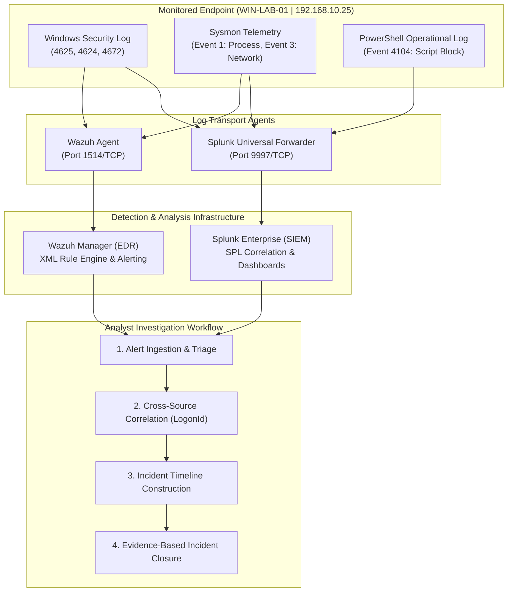

# SOC Alert Triage and Investigation Lab
### Splunk, Sysmon, Windows Event Logs, and Wazuh EDR

[](LICENSE)
[](docs/log-sources.md)
[](splunk/)
[](wazuh/)
[](scripts/validate_sample_data.py)

A practical, hands-on detection engineering and SOC alert investigation project. This repository models the end-to-end lifecycle of a junior SOC analyst: analyzing Windows authentication anomalies, correlating failed and successful logons, investigating living-off-the-land process executions, evaluating PowerShell evasion techniques, building unified incident timelines, and authoring custom detection rules in Wazuh.

---

## Table of Contents
1. [Project Overview & Learning Objectives](#project-overview--learning-objectives)
2. [Lab Architecture](#lab-architecture)
3. [Technologies & Tools Used](#technologies--tools-used)
4. [Investigation Scenarios](#investigation-scenarios)
5. [Repository Structure](#repository-structure)
6. [Featured Splunk SPL Investigation](#featured-splunk-spl-investigation)
7. [Wazuh Custom Detection Rules](#wazuh-custom-detection-rules)
8. [Data Validation & Quick Start](#data-validation--quick-start)
9. [Reproduction Guide for Live Labs](#reproduction-guide-for-live-labs)
10. [Project Status & Honest Limitations](#project-status--honest-limitations)
11. [License](#license)

---

## Project Overview & Learning Objectives

In an enterprise Security Operations Center (SOC), tier-1 and tier-2 analysts are bombarded with authentication and process alerts. The primary challenge is not simply spotting anomalies, but **distinguishing benign user mistakes from targeted adversary intrusion** without succumbing to confirmation bias.

### Core Learning Objectives
- **Authentication Triage:** Analyze Windows Event ID 4625 sub-status codes (`0xC0000064` vs `0xC000006A`) to differentiate username enumeration from password guessing.
- **Cross-Source Correlation:** Bind Windows Security Event 4624 (`TargetLogonId: 0x14A28F`) directly to Sysmon Event ID 1 (`LogonId: 0x14A28F`) to track all post-logon process execution.
- **LOLBins & Evasion Detection:** Uncover Living-off-the-Land tradecraft using `cmd.exe` and `powershell.exe` with evasion arguments (`-ExecutionPolicy Bypass`, `-WindowStyle Hidden`).
- **Network Socket Linking:** Correlate process execution (Sysmon Event ID 1) with outbound network sockets (Sysmon Event ID 3) to identify external C2 egress.
- **Detection Engineering:** Write and validate custom XML detection rules for the Wazuh manager with MITRE ATT&CK mappings.

---

## Lab Architecture

The investigation pipeline reflects a real-world telemetry flow: endpoint telemetry generated on a Windows workstation is ingested into Splunk Enterprise for multi-dimensional SPL analysis and into Wazuh for real-time rule alerting.



---

## Technologies & Tools Used

- **SIEM / Analytics:** Splunk Enterprise & Search Processing Language (SPL)
- **Endpoint Detection & Response (EDR):** Wazuh 4.x Manager & Agent
- **Endpoint Telemetry:** Microsoft Sysmon v15+, Windows Advanced Security Auditing
- **Operating Systems:** Windows 10/11 Enterprise x64 (Endpoint), Ubuntu Server 22.04 LTS (Wazuh), Windows 11 (Physical Host)
- **Frameworks:** MITRE ATT&CK (Enterprise Matrix), NIST SP 800-61 Rev. 2
- **Testing & Quality Control:** Python 3 (JSON Schema & Cross-Event Correlation Validator)

---

## Investigation Scenarios

This repository documents 5 structured investigations based on an internally consistent, chronological simulated attack against host `WIN-LAB-01`:

| Investigation Report | Primary Log Source | Key Event IDs | Core Focus |
| :--- | :--- | :--- | :--- |
| **[01. Failed Logon Investigation](investigations/01-failed-logon-investigation.md)** | `WinEventLog:Security` | Event ID 4625 | Probing `admin_svc`, `Administrator`, and `jdoe`. Distinguishing bad password from non-existent user. |
| **[02. Authentication Correlation](investigations/02-authentication-correlation.md)** | `WinEventLog:Security` | Event IDs 4625, 4624, 4672 | Correlating failed attempts with subsequent successful RDP logon under `jdoe` (`LogonId: 0x14A28F`). |
| **[03. Suspicious Process Investigation](investigations/03-suspicious-process-investigation.md)** | `Microsoft-Windows-Sysmon/Operational` | Sysmon Event ID 1 | Post-logon process triage (`whoami /all`, staging output in `C:\Users\Public\`). |
| **[04. PowerShell Activity & Gaps](investigations/04-powershell-activity.md)** | Sysmon & PowerShell Operational | Sysmon 1 & 3, Win 4104 | Discovery cmdlets, hidden windows, outbound C2 socket to `198.51.100.42:443`, and telemetry gaps. |
| **[05. Master Incident Summary](investigations/05-investigation-summary.md)** | Multi-Source | All | Root cause analysis, full attack timeline, MITRE ATT&CK mapping, and containment roadmap. |

---

## Repository Structure

```
soc-alert-triage-investigation-lab/
├── README.md                               # Project overview, architecture, and navigation
├── LICENSE                                 # MIT Open Source License
├── .gitignore                              # Git exclusion rules for logs, VM files, and cache
├── docs/
│   ├── lab-architecture.md                 # Network topology, communication matrix, and data flow
│   ├── investigation-methodology.md        # 6-step SOC triage and hypothesis-testing framework
│   ├── log-sources.md                      # Windows Event Log and Sysmon field reference guide
│   └── limitations.md                      # Honest comparison between this lab and enterprise SOCs
├── sample-data/
│   ├── README.md                           # Metadata, schema, and Splunk ingestion guide
│   ├── windows-security-events.json        # Synthetic Windows Security logs (4625, 4624, 4672)
│   └── sysmon-events.json                  # Synthetic Sysmon logs (Event 1 Process, Event 3 Network)
├── splunk/
│   ├── failed-logon-analysis.spl           # Failed authentication analysis & sub-status triage
│   ├── authentication-correlation.spl      # Correlation between failures and subsequent success
│   ├── suspicious-process-analysis.spl     # Sysmon process creation & LOLBin analysis
│   ├── powershell-investigation.spl        # PowerShell execution policy & script triage
│   └── investigation-timeline.spl          # Unified cross-source incident timeline
├── wazuh/
│   ├── README.md                           # Wazuh rule placement, testing, and deployment guide
│   └── local-rules.xml                     # Custom XML detection rules (100050 - 100053)
├── investigations/
│   ├── 01-failed-logon-investigation.md    # Investigation report: Event ID 4625
│   ├── 02-authentication-correlation.md   # Investigation report: Event 4625 to 4624
│   ├── 03-suspicious-process-investigation.md # Investigation report: Sysmon Event ID 1
│   ├── 04-powershell-activity.md           # Investigation report: Sysmon 1, 3 & Event 4104
│   └── 05-investigation-summary.md         # Master incident closure & containment report
├── dashboards/
│   └── dashboard-design.md                 # Splunk SOC triage dashboard layout & panel queries
├── scripts/
│   └── validate_sample_data.py             # Python script validating schema, chronology & correlation
└── screenshots/
    └── README.md                           # Evidence capture guidelines and sanitization checklist
```

---

## Featured Splunk SPL Investigation

### Cross-Source Authentication Correlation
This query correlates repeated failed authentications with a subsequent successful logon from the same source IP within a 30-minute window, outputting the LSA session token (`SessionLogonIDs`) needed for endpoint pivoting:

```spl
index=* (EventCode=4625 OR EventID=4625 OR EventCode=4624 OR EventID=4624)
| eval EventType=if(EventCode==4625 OR EventID==4625, "Failure (4625)", "Success (4624)")
| eval TargetUser=coalesce(TargetUserName, user, Account_Name)
| eval SourceIP=coalesce(IpAddress, src_ip, Source_Network_Address)
| eval LogonID=coalesce(TargetLogonId, LogonId, "N/A")
| filter TargetUser!="-" AND TargetUser!="SYSTEM"
| stats count(eval(EventType="Failure (4625)")) as FailCount,
        count(eval(EventType="Success (4624)")) as SuccessCount,
        earliest(eval(if(EventType="Failure (4625)", _time, null()))) as FirstFailureTime,
        latest(eval(if(EventType="Failure (4625)", _time, null()))) as LastFailureTime,
        earliest(eval(if(EventType="Success (4624)", _time, null()))) as SuccessTime,
        values(LogonID) as SessionLogonIDs,
        values(LogonType) as LogonTypes
        by SourceIP, TargetUser
| where FailCount > 0 AND SuccessCount > 0
| eval SecondsBetweenLastFailAndSuccess = SuccessTime - LastFailureTime
| where SecondsBetweenLastFailAndSuccess >= 0 AND SecondsBetweenLastFailAndSuccess <= 1800
| convert timeformat="%Y-%m-%d %H:%M:%S" ctime(FirstFailureTime) ctime(LastFailureTime) ctime(SuccessTime)
| table SourceIP, TargetUser, FailCount, SuccessCount, FirstFailureTime, LastFailureTime, SuccessTime, SecondsBetweenLastFailAndSuccess, SessionLogonIDs, LogonTypes
```

*See full queries in [splunk/](splunk/).*

---

## Wazuh Custom Detection Rules

Custom rules deployed inside `/var/ossec/etc/rules/local_rules.xml` to detect Windows brute-force patterns and Sysmon execution anomalies:

```xml
<!-- Rule 100052: Sysmon Process Creation with Evasion Flags -->
<rule id="100052" level="10">
  <if_group>sysmon_process_create</if_group>
  <field name="win.eventdata.image" type="pcre2">(?i)powershell\.exe$</field>
  <field name="win.eventdata.commandLine" type="pcre2">(?i)(-ExecutionPolicy\s+Bypass|-WindowStyle\s+Hidden|-w\s+hidden|-enc|-EncodedCommand)</field>
  <description>Sysmon: PowerShell executed with command-line evasion flags (Bypass / Hidden / Encoded) by user $(win.eventdata.user).</description>
  <mitre>
    <id>T1059.001</id>
    <id>T1562.001</id>
  </mitre>
</rule>
```

*See all detection rules in [wazuh/local-rules.xml](wazuh/local-rules.xml).*

---

## Data Validation & Quick Start

This repository includes a Python test script ([validate_sample_data.py](scripts/validate_sample_data.py)) that strictly validates the synthetic event schemas, ensures event timestamps are in chronological sequence, and confirms that cross-log correlation keys (such as `TargetLogonId` and `ProcessId`) align across files.

### Running Validation Locally
```bash
python scripts/validate_sample_data.py
```

### Actual Execution Output:
```
=================================================================
SOC SAMPLE DATASET INTEGRITY VALIDATOR
=================================================================
[PASS] Successfully parsed JSON: windows-security-events.json (6 events)
[PASS] Successfully parsed JSON: sysmon-events.json (4 events)
[PASS] Windows Security schema validated (Identified logon sessions: {'0x14A28F'})
[PASS] Sysmon schema validated (3 unique processes tracked)
[CORRELATION] Verified process hierarchy: Parent PID 4820 (cmd.exe) -> Child PID 5192 (powershell.exe)
[CORRELATION] Verified network socket linked to known process: PID 5192 (powershell.exe) -> 198.51.100.42:443
-----------------------------------------------------------------
[PASS] Zero warnings detected.

[SUCCESS] All datasets passed schema, chronology, and correlation validation.
=================================================================
```

---

## Reproduction Guide for Live Labs

To reproduce this investigation in a live virtualized home lab:

1. **Endpoint Provisioning (VMware Workstation):**
   - Install Windows 10/11 Enterprise Evaluation (4 GB RAM, 2 vCPUs).
   - Configure Advanced Audit Policies (`secpol.msc`): Enable Success/Failure auditing for *Logon*, *Process Creation*, and *Special Logon*.
   - Install Sysmon v15+ using the modular configuration (e.g., SwiftOnSecurity or Olaf Hartong schema).
2. **SIEM / Forwarder Ingestion:**
   - Install Splunk Enterprise on the host machine or a Linux VM.
   - Configure Splunk receiving on port `9997/TCP`.
   - Install Splunk Universal Forwarder on the Windows endpoint pointing to the Splunk receiver.
3. **Simulating Activity:**
   - Execute test authentications via RDP or network shares from a secondary VM or test script.
   - Run safe, non-destructive discovery commands (`whoami /all`, `Get-NetTCPConnection`) to observe real-time telemetry generation.

---

## Project Status & Honest Limitations

### Current Deliverable Status
- **Phase 1: Project Architecture & Schemas:** 🟢 Completed & Validated
- **Phase 2: Investigation Reports (Simulated):** 🟢 Completed & Documented
- **Phase 3: Splunk SPL Query Suite:** 🟢 Completed & Documented
- **Phase 4: Wazuh Custom Rules:** 🟢 Completed & Formatted
- **Phase 5: Live Lab Verification (Endpoint Telemetry):** 🟡 Ready for live VM hookup

### Technical Limitations & Lab Disclaimers
1. **Synthetic Test Data:** The events documented here are explicitly simulated test fixtures designed for search verification and portfolio demonstration. They do not represent live telemetry harvested from a production corporate network.
2. **Standalone vs. Active Directory:** The lab endpoint is a standalone Windows workstation. Domain-level Kerberos telemetry (Event 4768 / 4769) is not simulated.
3. **Script Block Logging Prerequisite:** As documented in [Investigation 04](investigations/04-powershell-activity.md), full visibility into PowerShell requires enabling Event 4104 in Group Policy to close telemetry gaps.

---

## License

This project is licensed under the [MIT License](LICENSE). Educational use and portfolio adaptation are encouraged.
