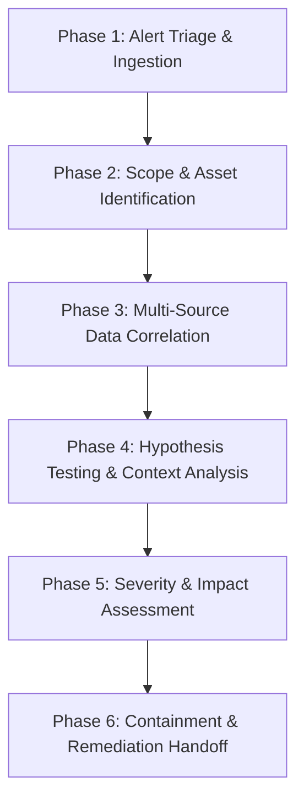

# SOC Alert Triage & Investigation Methodology

## 1. Investigation Framework Overview

In a Security Operations Center (SOC), tier-1 and tier-2 analysts are responsible for evaluating telemetry alerts, qualifying whether an alert represents benign noise, user error, or malicious activity, and building an evidence-based timeline before taking containment actions.

This lab adopts a 6-phase triage methodology aligned with the NIST SP 800-61 Rev. 2 Computer Security Incident Handling Guide:

---

## 2. Phase-by-Phase Execution

### Phase 1: Alert Triage & Initial Ingestion
- **Objective:** Review the initial trigger, extract key indicators, and determine whether immediate escalation is warranted.
- **Key Questions:**
  - What detection rule or signature triggered the alert?
  - What is the initial severity level and confidence score?
  - Is the affected asset critical infrastructure or a standard endpoint?

### Phase 2: Scope & Asset Identification
- **Objective:** Map the affected IP addresses, hostnames, and user accounts.
- **Actions:**
  - Verify if the source IP (`src_ip`) is internal (RFC 1918) or external.
  - Check the target user account (`TargetUserName`): Is it a domain admin, standard user, or service account?
  - Establish the baseline role of the workstation (`Computer`): Is this a developer box, database server, or standard office workstation?

### Phase 3: Multi-Source Data Correlation
- **Objective:** Connect disparate log streams using reliable correlation anchors.
- **Correlation Anchors:**
  - `TargetLogonId` / `LogonId`: Binds the Windows authentication event (4624) directly to all subsequent child processes spawned under that logon session in Sysmon Event ID 1.
  - `ProcessId` (PID) & `ProcessGuid`: Tracks parent-to-child lineage (e.g., `explorer.exe` -> `cmd.exe` -> `powershell.exe`).
  - `Source IP` & `Port`: Correlates network connections (Sysmon Event ID 3) with firewall logs and authentication logs.

### Phase 4: Hypothesis Testing (Avoiding Confirmation Bias)
A critical responsibility of an analyst is to avoid jumping to conclusions. Every observation must be tested against two competing hypotheses:

| Observation | Malicious Hypothesis (Adversary) | Benign Hypothesis (False Positive / User Error) |
| :--- | :--- | :--- |
| **Repeated 4625 Logon Failures** | Brute force or password spraying attack. | User changed domain password; mobile device or mapped drive is attempting authentication with stale cached credentials. |
| **Logon Success following Failures** | Adversary guessed password or compromised credentials. | Legitimate employee remembered their new password after two failed attempts. |
| **PowerShell with Bypass Flags** | Living-off-the-Land (LotL) execution, C2 stager. | IT automation, software installer, or administrative maintenance script. |
| **File written to `C:\Users\Public\`** | Adversary staging enumeration data for exfiltration. | Shared printer driver or non-malicious application storing public cache data. |

> **Analyst Rule:** A successful logon following failed attempts **cannot** be classified as a breach on its own without post-logon forensic evidence (e.g., unauthorized process creation, execution of discovery commands, unusual network egress).

### Phase 5: Severity & Impact Assessment
- Severity is calculated using:
  $$\text{Severity} = \text{Asset Criticality} \times \text{Confidence of Malicious Intent} \times \text{Observed Impact}$$
- Low: Single isolated failure or standard administrative activity.
- Medium: Suspicious process execution with ambiguous business justification.
- High: Verified credential compromise followed by active internal discovery or external C2 connection.

### Phase 6: Containment & Remediation Handoff
- Isolate the endpoint from the network via EDR/firewall.
- Revoke active Kerberos/NTLM sessions and force password reset for the compromised account.
- Block external destination IPs/domains at the perimeter gateway.
- Preserve memory and forensic triage packages for Tier-3/DFIR teams.
