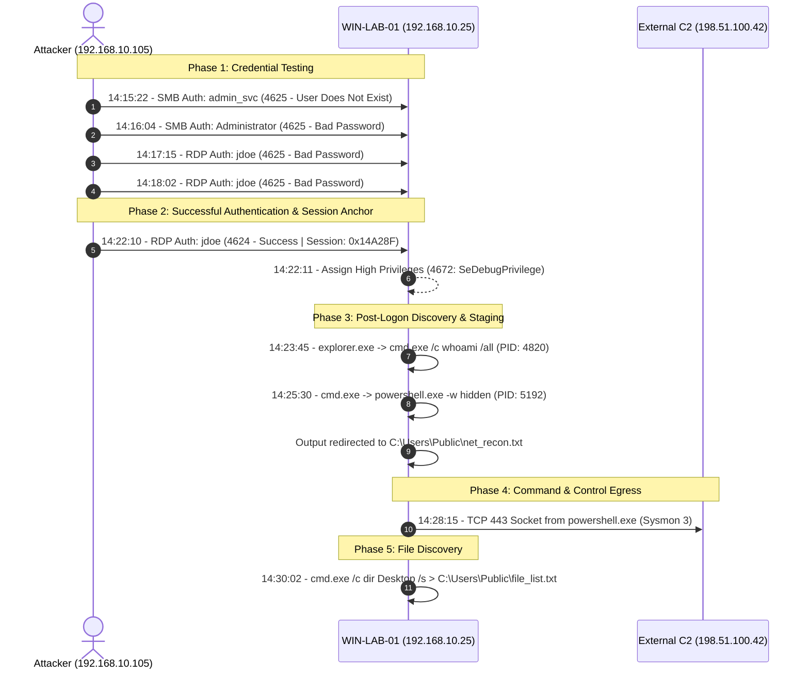

# Investigation 05: Master Incident Summary & Containment Report

## 1. Executive Summary

| Incident Reference | Date of Activity | Target Asset | Attacker Source IP | Impact Level | Final Classification |
| :--- | :--- | :--- | :--- | :--- | :--- |
| **INC-2026-1024-01** | `2026-10-24` | `WIN-LAB-01.LAB.LOCAL` (`192.168.10.25`) | `192.168.10.105` | **High** | Confirmed Unauthorized Access & Reconnaissance |

On October 24, 2026, between 14:15 UTC and 14:30 UTC, an unauthorized actor operating from internal host `192.168.10.105` conducted credential testing against multiple administrative accounts on workstation `WIN-LAB-01`. At 14:22 UTC, the actor established a successful Remote Desktop Protocol (RDP) session using compromised credentials for local administrator `jdoe`. 

Following authentication, the actor spawned elevated command shells, conducted system privilege and network listening port enumeration, staged output files in `C:\Users\Public\`, and established an outbound encrypted network socket (port 443) to external IP `198.51.100.42`. 

Immediate host isolation, credential revocation, and firewall blocking have been recommended to prevent lateral movement or data exfiltration.

> **Data Notice:** Findings documented in this report are simulated results derived from the unified test datasets [windows-security-events.json](file:///c:/Users/YOGESH/Downloads/SOC%20Home%20Lab/sample-data/windows-security-events.json) and [sysmon-events.json](file:///c:/Users/YOGESH/Downloads/SOC%20Home%20Lab/sample-data/sysmon-events.json).

---

## 2. Complete End-to-End Attack Timeline

---

## 3. MITRE ATT&CK Matrix Alignment

| Tactic | Technique ID | Technique Name | Evidence in this Investigation |
| :--- | :--- | :--- | :--- |
| **Credential Access** | `T1110.003` | Password Spraying | Probing `admin_svc`, `Administrator`, and `jdoe` from `192.168.10.105`. |
| **Initial Access** | `T1078.003` | Valid Accounts: Local Accounts | Successful RDP logon using `jdoe` (Event 4624). |
| **Lateral Movement** | `T1021.001` | Remote Desktop Protocol | Inbound port 3389 RDP connection (LogonType 10). |
| **Privilege Escalation**| `T1068` | Exploitation for Privilege Escalation | Session granted `SeDebugPrivilege` (Event 4672). |
| **Execution** | `T1059.001` | Command & Scripting: PowerShell | `powershell.exe` execution with `-ExecutionPolicy Bypass`. |
| **Defense Evasion** | `T1562.001` | Impair Defenses: Disable Tools | Execution policy bypass and `-WindowStyle Hidden`. |
| **Discovery** | `T1033` | System Owner/User Discovery | Execution of `whoami /all`. |
| **Discovery** | `T1049` | System Network Connections Discovery | `Get-NetTCPConnection` pipe to file. |
| **Discovery** | `T1083` | File and Directory Discovery | `dir C:\Users\jdoe\Desktop /s`. |
| **Collection** | `T1074.001` | Data Staged: Local Data Staging | Writing artifacts into `C:\Users\Public\`. |
| **Command & Control** | `T1071.001` | Application Layer Protocol: Web | Outbound socket from PowerShell PID 5192 to `198.51.100.42:443`. |

---

## 4. Root Cause Analysis

1. **Weak Credential Hygiene:** The account `jdoe` used a password susceptible to credential guessing within 4 attempts.
2. **Excessive User Privileges:** User account `jdoe` had direct membership in the local Administrators group, granting debug privileges (`SeDebugPrivilege`) not required for daily tasks.
3. **Unrestricted Inbound RDP:** Port 3389 was reachable across the internal subnet without Network Level Authentication (NLA) restrictions or Multi-Factor Authentication (MFA).
4. **Lack of Account Lockout Policy:** The workstation did not lock the account after consecutive authentication failures.

---

## 5. Containment & Remediation Roadmap

### Immediate Containment (0 - 2 Hours):
- [x] **Network Isolation:** Disconnect `WIN-LAB-01` from the local network segment to halt active RDP sessions and outbound C2 traffic.
- [x] **Credential Revocation:** Immediately reset the password for `jdoe` across the domain/workgroup and terminate all active sessions.
- [x] **Perimeter Egress Block:** Add firewall drop rule for destination IP `198.51.100.42` across all ports.
- [x] **Secondary Asset Triage:** Quarantine source host `192.168.10.105` to determine if it is an attacker-controlled staging machine or compromised employee workstation.

### Eradication & Remediation (2 - 24 Hours):
- [x] **Staged Artifact Deletion:** Safely capture forensic copies of `C:\Users\Public\net_recon.txt` and `C:\Users\Public\file_list.txt` before removing them from the host.
- [x] **Persistence Verification:** Inspect Windows Task Scheduler (`schtasks /query`), Startup folders, and Registry Run keys (`HKLM\Software\Microsoft\Windows\CurrentVersion\Run`) for unauthorized persistence items.
- [x] **Memory Dump Collection:** Preserve RAM image of `WIN-LAB-01` to analyze in-memory payloads injected by PowerShell PID 5192.

### Long-Term Hardening (Post-Incident):
- Enable **PowerShell Script Block Logging (Event ID 4104)** across all Windows endpoints via GPO.
- Enforce **Account Lockout Policy** (e.g., lock account for 30 minutes after 5 invalid attempts).
- Enforce **Multi-Factor Authentication (MFA)** for all interactive Remote Desktop connections.
- Restrict write permissions on `C:\Users\Public\` using AppLocker or Software Restriction Policies.
